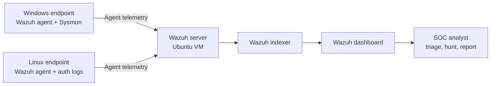

# Real SOC Home Lab — Wazuh + Windows + Linux

> **Project status: Documentation scaffold — hands-on deployment and validation are pending.**  
> This repository contains the architecture, implementation plan, detection backlog, investigation templates, and evidence structure. It does **not** claim that Wazuh has been installed, endpoints enrolled, alerts generated, or detections tested. Those sections will be updated only after the lab is run and evidence is captured.

A portfolio-grade, defensive security monitoring lab designed to demonstrate the workflow of a junior Security Operations Center (SOC) analyst: collect endpoint telemetry, centralize events, investigate alerts, map activity to MITRE ATT&CK, document decisions, and recommend response actions.

## Project at a glance

| Area | Planned implementation |
|---|---|
| SIEM / XDR platform | Wazuh all-in-one (server, indexer, dashboard) |
| SIEM host | Ubuntu Server VM |
| Endpoint 1 | Windows host with Wazuh agent and Sysmon |
| Endpoint 2 | Linux endpoint with Wazuh agent |
| Main skills | Log collection, alert triage, Windows/Linux event analysis, detection validation, incident reporting |
| Lab scope | Local, isolated, owned systems and synthetic test activity |
| Current state | Design and documentation prepared; deployment not yet validated |

## Objectives

1. Build a small, reproducible SOC monitoring environment.
2. Forward Windows and Linux security telemetry to a central Wazuh manager.
3. Understand alert fields, rule levels, agent health, and event timelines.
4. Validate selected detections using safe, controlled test events.
5. Investigate alerts and record evidence, false-positive considerations, and response recommendations.
6. Publish reproducible documentation without exposing secrets, personal data, or real endpoint identifiers.

## Architecture

See [architecture.md](docs/architecture.md) for the detailed design.



## Repository map

```text
wazuh-soc-home-lab/
├── README.md
├── docs/
│   ├── architecture.md
│   ├── build-and-validation-plan.md
│   ├── detection-use-cases.md
│   ├── investigation-workflow.md
│   └── lab-environment.md
├── detections/
│   └── README.md
├── investigations/
│   ├── README.md
│   └── templates/
│       └── incident-report-template.md
├── evidence/
│   ├── README.md
│   ├── screenshots/
│   │   └── README.md
│   └── sample-data/
│       └── README.md
└── journal/
    └── lab-log-template.md
```

## Build sequence

1. Confirm host OS, CPU virtualization support, free disk space, and VirtualBox/VMware choice.
2. Create the Ubuntu Server VM for the Wazuh all-in-one deployment.
3. Install Wazuh using the current official documentation and record exact versions.
4. Enrol the Windows endpoint; configure Sysmon and the Wazuh agent.
5. Enrol the Linux endpoint and verify authentication-log collection.
6. Validate agent connectivity and event ingestion before testing detections.
7. Run the controlled use cases in [detection-use-cases.md](docs/detection-use-cases.md).
8. Investigate each generated alert and complete a report using the template.
9. Add redacted screenshots and measured results to the evidence folders.

**Do not skip validation:** an agent showing as active is not by itself proof that every expected event is being collected.

## Planned detection coverage

- Windows failed logon activity (Security Event ID 4625)
- Windows successful logon context (4624)
- New local account creation (4720)
- Local group membership change (4728 / 4732, depending on group type)
- Sysmon process creation (Event ID 1)
- Linux SSH authentication failures and successes
- Repeated authentication failures followed by a success (correlation / investigation use case)

Use [detection-use-cases.md](docs/detection-use-cases.md) as the validation backlog. Event IDs are investigation starting points, not proof of malicious activity.

## Evidence and honesty standard

Every completed lab should include:
- Date, platform versions, endpoint role, and test steps
- Relevant alert/event details with timestamps
- Screenshot(s) with secrets and personal identifiers redacted
- Analyst interpretation and MITRE ATT&CK mapping where justified
- False-positive / benign explanation considered
- Outcome and recommended next action

Until that evidence exists, label the use case **Planned** or **Not yet validated**. Never fabricate screenshots, alert counts, incident outcomes, or test results.

## Safety

Only monitor systems you own or are explicitly authorized to administer. Keep attack simulations inside the isolated lab. Use synthetic accounts and harmless test actions. Do not upload API keys, passwords, tokens, private IP details if sensitive, personal usernames, or unredacted logs.

## References

- [Wazuh documentation](https://documentation.wazuh.com/current/index.html)
- [Wazuh quickstart](https://documentation.wazuh.com/current/quickstart.html)
- [Wazuh agent deployment](https://documentation.wazuh.com/current/user-manual/agents/index.html)
- [Microsoft Sysmon](https://learn.microsoft.com/sysinternals/downloads/sysmon)
- [Microsoft Windows security auditing](https://learn.microsoft.com/windows/security/threat-protection/auditing/basic-audit-policy-recommendations)
- [MITRE ATT&CK](https://attack.mitre.org/)

## Author

**Tanveer Hassham** — Cybersecurity student | SOC Analyst learning portfolio

This is an educational home lab, not a production SOC deployment or a claim of professional operational experience.
