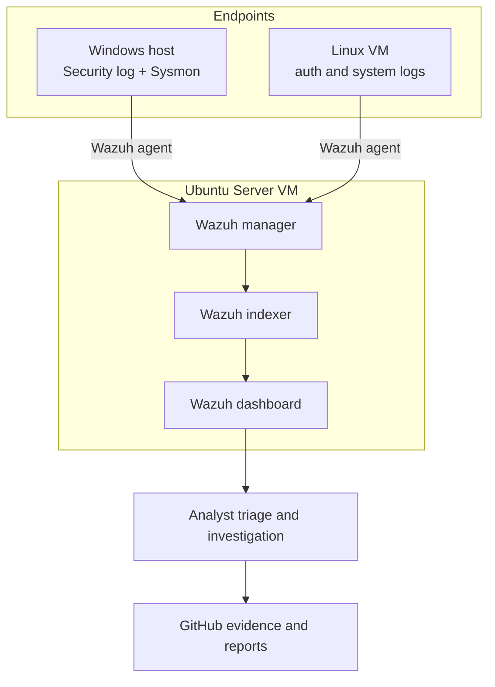

# Lab Architecture

## 1. Design goals

- Centralize endpoint security telemetry in one Wazuh environment.
- Keep the initial topology small enough for a 16 GB RAM laptop.
- Separate the SIEM server from endpoint telemetry sources.
- Make the design easy to reproduce and document.
- Avoid exposing the lab to untrusted networks.

## 2. Logical components

| Component | Role | Planned configuration |
|---|---|---|
| Ubuntu Server VM | Wazuh all-in-one host | Wazuh server, indexer, dashboard |
| Windows endpoint | Endpoint telemetry source | Wazuh agent + Sysmon |
| Linux endpoint | Endpoint telemetry source | Wazuh agent + authentication/system logs |
| Analyst workstation | Administration and analysis | Browser, SSH/console, GitHub documentation |

## 3. Resource plan

The initial design targets one Ubuntu VM with approximately 4 vCPU, 8 GB RAM, and 60 GB virtual disk, subject to the current Wazuh sizing guidance and actual host capacity. Windows remains the physical host endpoint initially. A separate Linux endpoint VM can be added only if memory and disk headroom allow; otherwise use a lightweight Linux VM with reduced resources or defer it until the core SIEM is stable.

Do not allocate all physical RAM to virtual machines. Keep sufficient memory for the host operating system and browser.

## 4. Data flow

1. Windows generates Security and Sysmon events.
2. The Windows Wazuh agent collects configured event channels and forwards events.
3. Linux generates authentication and system events.
4. The Linux Wazuh agent collects configured log sources and forwards events.
5. Wazuh manager analyses incoming data using decoders and rules.
6. Events and alerts are indexed for dashboard search and investigation.
7. Analyst reviews context, validates the event, records findings, and recommends response.

## 5. Network and safety boundaries

- Prefer a host-only or otherwise restricted virtual network for VM-to-VM lab traffic.
- Permit only the management and agent communication ports required by the chosen Wazuh version and deployment.
- Do not expose the Wazuh dashboard or agent ports directly to the public internet.
- Use strong, unique credentials and never commit them to Git.
- Take a VM snapshot after a known-good installation.
- Use synthetic accounts and controlled test events.

Exact ports and firewall rules must be checked against the installed Wazuh version's official documentation before configuration.

## 6. Architecture diagram

## 7. Known limitations

- A single laptop lab is not highly available and is not production-grade.
- Events may be missed if audit policy, agent configuration, or log permissions are incorrect.
- Detection quality depends on telemetry quality and rule configuration.
- Screenshots alone do not prove full coverage; event fields and reproducible test steps are also required.
